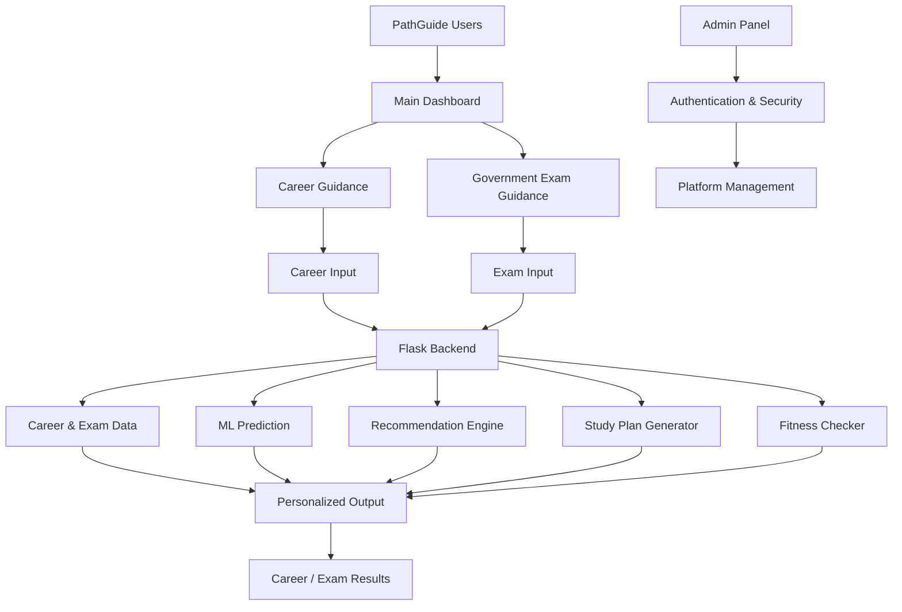
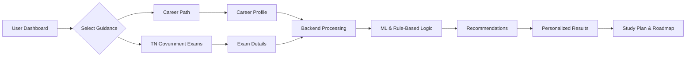

# 🧭 PathGuide AI

### Career Guidance & Tamil Nadu Government Exam Preparation Platform

<p align="center">
  <strong>Navigate Your Future. Discover Your Path. Achieve Your Goals.</strong>
</p>

<p align="center">
  
  
  
  
</p>

<p align="center">
  
  
  
  
</p>

---

## 🌟 Overview

**PathGuide AI** is an intelligent, bilingual career and government examination guidance platform designed especially for students and aspirants in Tamil Nadu.

The platform combines **Career Path Guidance** and **Tamil Nadu Government Exam Preparation** into a single application, helping users make informed decisions through personalized recommendations, Machine Learning-assisted predictions, and structured study plans.

With its English and Tamil interface, PathGuide makes career exploration and government exam preparation more accessible, organized, and user-friendly.

### 🎯 Two Intelligent Guidance Paths

| 🎓 College Career Path | 🏛️ Tamil Nadu Government Exams |
|:---|:---|
| Degree-based career exploration | Government examination guidance |
| Department and domain selection | TNPSC and TNUSRB preparation |
| Personalized career recommendations | Exam preparation strategies |
| Skill development roadmap | Structured study plans |
| Courses and project suggestions | Success-score estimation |
| Internship and salary insights | Physical fitness eligibility |

---

## ✨ Core Features

### 🎓 1. Career Guidance System

An intelligent career guidance module that helps students discover suitable career opportunities based on their educational background and professional interests.

- Dynamic selection: Degree → Department → Domain → Role.
- Career recommendations from a dataset of 1,000 roles.
- Personalized career roadmap.
- Required skills and technology recommendations.
- Course, project and internship suggestions.
- Salary information for selected roles.
- Location-based career guidance.
- Weekly study planning and progress tracking.

### 🏛️ 2. Tamil Nadu Government Exam Guidance

A dedicated preparation system for students aspiring to enter Tamil Nadu government services.

- TNPSC and TNUSRB examination guidance.
- Qualification-based exam selection.
- Exam preparation duration and study availability inputs.
- Structured examination preparation strategies.
- Success-score estimation.
- Physical fitness and BMI evaluation for applicable uniformed services.
- Personalized preparation recommendations.

### 🤖 3. Machine Learning & Intelligence

PathGuide incorporates Machine Learning and rule-based recommendation techniques to support personalized guidance.

| Component | Purpose |
|---|---|
| Random Forest Predictor | ML-assisted success estimation |
| Recommendation Engine | Personalized learning recommendations |
| Daily Plan Generator | Daily preparation tasks |
| Fitness Checker | BMI and physical eligibility evaluation |
| Rule-Based Logic | Converts user inputs into actionable guidance |

### 📅 4. Smart Study Planning

- Personalized preparation roadmaps.
- Weekly study schedules.
- Daily learning activities.
- Study-hour-based planning.
- Preparation-duration-based recommendations.
- Skill development and learning suggestions.

### 🌐 5. Bilingual User Experience

- English and Tamil language support.
- Dynamic language switching.
- User-friendly navigation.
- Responsive interface for desktop, tablet and mobile.
- Modern interface with consistent visual branding.
- Light and dark themes in the admin dashboard.

### 🔐 6. Admin Management System

A protected administration interface for managing platform operations.

- Secure admin authentication.
- Failed login attempt tracking.
- Account lockout mechanism.
- Session inactivity timeout.
- Feature activation and deactivation.
- Welcome banner management.
- Report and audit-log exports.
- Backup management.
- Administrative configuration.

---

## 🧠 Machine Learning Architecture

PathGuide combines predictive intelligence with rule-based planning to generate actionable recommendations.

### ML Components

**1. Success Prediction**
- Uses a Random Forest-based prediction approach.
- Processes relevant preparation inputs.
- Generates a success-oriented estimate.

**2. Recommendation Engine**
- Analyzes user selections and preparation requirements.
- Generates personalized learning recommendations.
- Supports career and examination planning.

**3. Daily Plan Generator**
- Converts preparation requirements into daily activities.
- Organizes learning tasks based on available study time.

**4. Fitness Checker**
- Calculates BMI.
- Evaluates applicable physical eligibility criteria.
- Provides fitness-related guidance.

> **Implementation note:** The predictor, recommendation and related ML modules are present in the codebase. The current running application uses career data and generator modules directly; the complete ML pipeline and database models are still being integrated.

---

## 🏗️ System Architecture

PathGuide follows a modular web application architecture with a Flask backend, frontend templates, data modules and Machine Learning components.



### Application Workflow



---

## 🧰 Technology Stack

| Layer | Technologies |
|---|---|
| Programming Language | Python 3.8+ |
| Backend Framework | Flask 2.3 |
| Frontend | HTML5, CSS3, JavaScript |
| Template Engine | Jinja2 |
| Machine Learning | scikit-learn |
| ML Algorithm | Random Forest |
| Data Processing | NumPy, Pandas |
| Model Management | Joblib |
| Data Sources | Python modules, CSV datasets |
| Database Layer | Database models and initialization scripts |
| Version Control | Git, GitHub |
| Development Environment | Visual Studio Code |

---

## 📁 Project Structure

```text
PathGuide/
│
├── README.md
├── index.html
├── requirements.txt
│
└── Code/
    │
    ├── app.py
    ├── requirements.txt
    ├── .env.example
    │
    ├── backend/
    │   ├── app.py
    │   ├── career_output_generator.py
    │   ├── config.py
    │   ├── init_db.py
    │   │
    │   ├── ml/
    │   │   ├── success_predictor.py
    │   │   ├── recommendation_engine.py
    │   │   ├── daily_plan_generator.py
    │   │   └── fitness_checker.py
    │   │
    │   ├── models/
    │   │   ├── career.py
    │   │   └── exam.py
    │   │
    │   └── utils/
    │
    ├── data/
    │   ├── career_data.py
    │   ├── role_content.py
    │   └── Career Path Roles.csv
    │
    ├── frontend/
    │   ├── templates/
    │   │   ├── index.html
    │   │   ├── career_input.html
    │   │   ├── career_output.html
    │   │   ├── exam_input.html
    │   │   ├── exam_output.html
    │   │   └── partials/
    │   │
    │   └── static/
    │       ├── css/
    │       ├── js/
    │       └── img/
    │
    ├── docs/
    │   ├── PROJECT_SUMMARY.md
    │   ├── ARCHITECTURE.py
    │   └── QUICKSTART.md
    │
    └── scripts/
        ├── run.ps1
        └── verify_setup.ps1
```

---

## ⚙️ Getting Started

### Prerequisites

- Python 3.8 or newer
- Git
- Visual Studio Code

### 1. Clone the Repository

```powershell
git clone https://github.com/suvinbrettleeroy/PathuGuide-AI.git

cd PathuGuide-AI
```

### 2. Navigate to the Code Directory

```powershell
cd Code
```

### 3. Create a Virtual Environment

```powershell
python -m venv venv
```

### 4. Activate the Environment

```powershell
.\venv\Scripts\Activate.ps1
```

### 5. Install Dependencies

```powershell
pip install -r requirements.txt
```

### 6. Configure Environment Variables

Copy `.env.example` to `.env` and configure the required application settings and secure admin credentials.

### 7. Run the Application

```powershell
python app.py
```

### 8. Open in Browser

```text
http://127.0.0.1:5000
```

---

## 🔗 Application Routes

| Route | Description |
|---|---|
| `/` | Main dashboard |
| `/career/input` | Career guidance input |
| `/career/output` | Personalized career results |
| `/exam/input` | Government exam input |
| `/exam/output` | Exam preparation results |
| `/admin-login` | Admin authentication |
| `/admin` | Admin dashboard |
| `/api/career/*` | Career selection and progress APIs |

---

## 📊 Development Status

| Module | Status |
|---|---|
| Main Dashboard | Implemented |
| Career Guidance | Implemented |
| Government Exam Guidance | Implemented |
| English & Tamil Support | Implemented |
| Flask Backend | Implemented |
| Career Recommendation Logic | Implemented |
| Career Data Integration | Implemented |
| Admin Authentication | Implemented |
| Admin Management | Implemented |
| Random Forest Predictor | Codebase implementation; integration in progress |
| Recommendation Engine | Codebase implementation |
| Daily Plan Generator | Codebase implementation |
| Fitness Checker | Codebase implementation |
| Complete Database Integration | In progress |

---

## 🔮 Future Enhancements

- [ ] Advanced ML prediction and model evaluation.
- [ ] Improved recommendation explainability.
- [ ] Expanded career and examination datasets.
- [ ] Advanced learning analytics dashboard.
- [ ] User profile and long-term progress tracking.
- [ ] Persistent database integration.
- [ ] AI-powered conversational career assistant.
- [ ] Real-time examination notifications.
- [ ] Resume analysis and skill-gap identification.
- [ ] Mobile application integration.

---

## 👥 Team Members

| Team Member | Responsibilities |
|---|---|
| **Suvin Brettlee Roy B.** | Team Lead, System Architecture, Frontend, Backend, UI/UX and Integration |
| **Duraimurugan K.** | Data Collection, Data Processing, ML and Recommendation Development |
| **Brian Benton Nelson P.** | Testing, Debugging, Output Validation and Documentation |

---

## 🎯 Project Objectives

- Integrate career guidance and government exam preparation into one platform.
- Provide personalized recommendations based on individual user profiles.
- Implement ML-assisted prediction and intelligent guidance.
- Generate structured daily and weekly study plans.
- Improve accessibility through English and Tamil language support.
- Provide secure administration and efficient platform management.

---

## 👨‍💻 Developer

**Suvin Brettlee Roy B.**

B.Tech – Computer Science and Engineering  
Artificial Intelligence & Machine Learning

**Technical Interests:**  
Artificial Intelligence · Machine Learning · Full-Stack Development · Data Science · Generative AI · AI Agents · Automation

[GitHub Profile](https://github.com/suvinbrettleeroy)

---

## 🙏 Acknowledgments

- Tamil Nadu Public Service Commission (TNPSC)
- Tamil Nadu Uniformed Services Recruitment Board (TNUSRB)
- Flask and Python communities
- Open-source Machine Learning community

---

<p align="center">
  <strong>🧭 PATHGUIDE AI</strong>
  <br/>
  <em>Career Path and Tamil Nadu Government Exam Path</em>
  <br/><br/>
  <strong>Navigate Your Future.</strong>
  <br/><br/>
  ⭐ If you find this project interesting, consider starring the repository!
  <br/><br/>
  <sub>Built with ❤️ using Python, Flask and Machine Learning.</sub>
  <br/>
  <sub>© 2026 PathGuide AI · Educational Project</sub>
</p>
